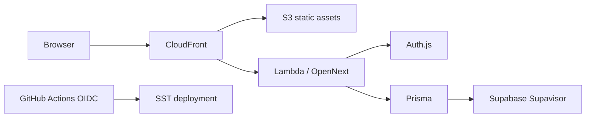

# Stordex architecture

## Deployed topology

Stordex is a Next.js 16 multi-tenant application deployed with SST/OpenNext in
AWS Tokyo (`ap-northeast-1`). Staging PostgreSQL uses the private `stordex`
schema in the shared `nammoku-staging-tokyo` Supabase project. Production
PostgreSQL runs on AWS and does not use Supabase.

No application VPC, NAT Gateway, Aurora cluster, App Runner service, or
long-lived AWS access key is required.

## Database connections

- Runtime `DATABASE_URL`: Supabase Transaction Pooler, port 6543.
- Migration `DIRECT_URL`: Supavisor Session Pooler on port 5432 for the
  IPv4-based GitHub Actions runner.
- Lambda-side `pg` pool maximum: one connection per warm container.
- The shared Supabase project is staging-only; production uses AWS PostgreSQL.

## Environments

- local: local PostgreSQL and `npm run dev`.
- staging: SST stage `staging`, automatically deployed from `main`.
- production: SST stage `prod`, manual protected workflow only.

Tenant authorization remains application-enforced: every server-side query and
mutation must derive tenant identity from the authenticated session.
